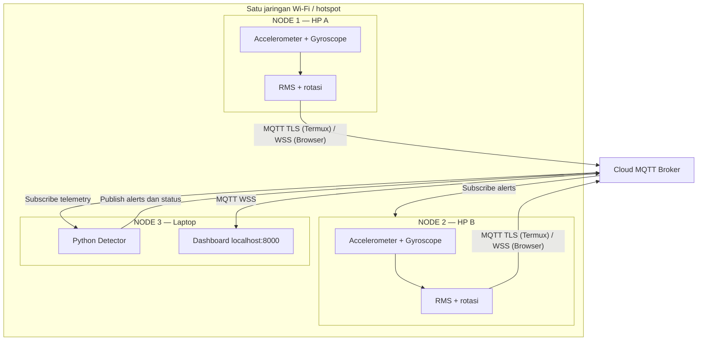
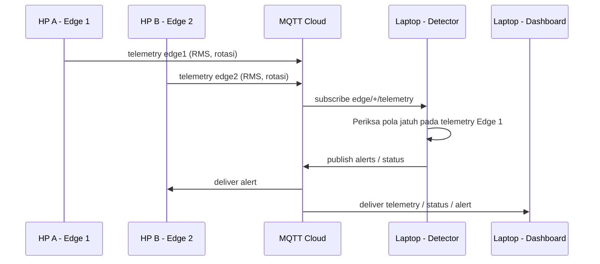

# Arsitektur IoT

Ada tiga node utama, berjalan **pada tiga perangkat fisik**: dua HP sebagai edge dan satu laptop sebagai detector/dashboard.

## Peran node

| Node | Perangkat | Input | Processing | Output |
|---|---|---|---|---|
| Edge 1 | HP A | Accelerometer + gyroscope | RMS + integrasi rotasi | Telemetry MQTT |
| Edge 2 | HP B | Accelerometer + gyroscope | RMS + integrasi rotasi | Telemetry MQTT + terima alert |
| Detector | Laptop | Telemetry dari broker | Sensor fusion rule-based | Status / alert MQTT |
| Dashboard | Browser laptop | Status / telemetry MQTT | Visualisasi | Grafik & ARM/DISARM |
| Broker | Cloud | Publish MQTT | Routing topic | Pesan ke subscriber |

**Dua cara menjalankan edge asli:** Termux:API dengan Python atau browser melalui HTTPS dengan DeviceMotionEvent. Keduanya menghasilkan payload JSON identik. Source: `shared/processing.py` dan `web-edge/index.html`.

## Data flow

Catatan: dashboard localhost tidak bisa diakses lewat `localhost` HP. Browser edge harus memakai origin HTTPS dari hosting tersendiri.
